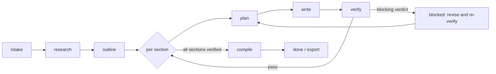

<p align="center">
  
</p>

<p align="center">
  <strong>Turn an assignment prompt into a sourced draft, one section at a time, with every citation checked against the live record before the section can ship.</strong>
</p>

<p align="center">
  <a href="https://github.com/ZeusCraft10/pensmith/actions/workflows/ci.yml"></a>
  <a href="LICENSE"></a>
  =22.12">
  
</p>

<p align="center">
  <a href="#status">Status</a> ·
  <a href="#how-it-works">How it works</a> ·
  <a href="#the-citation-verifier">The verifier</a> ·
  <a href="#install">Install</a> ·
  <a href="#quick-start">Quick start</a> ·
  <a href="#command-reference">Commands</a> ·
  <a href="#configuration">Configuration</a>
</p>

---

Pensmith guides you through a paper-writing workflow: **intake → research → outline → (plan → write → verify, for each section) → compile → done**. It ships as a [Claude Code](https://claude.com/claude-code) plugin and as a Node.js command-line tool; both run the same `pensmith` CLI.

What makes it different from asking a model to write your paper: a section cannot be compiled or exported while it carries a citation the verifier flagged as `FABRICATED` or `MIS-CITED`, a citation it could not check because no registry answered (`UNRESOLVED`), a citation it cannot check at all because it was typed as text (`RAW_CITATION`) or does not parse (`UNPARSEABLE`), or a quote it marked `NOT_FOUND`. That check is deterministic, runs per section, and is not skippable.

## Status

**0.3.0-alpha.1 is an alpha**, the first release of a rebuild. Expect rough edges, and read what it does today:

- **Drafting needs an API key.** Intake questions, outlines, section plans and drafts are generated by the pensmith CLI's own calls to Anthropic, in the plugin as well as on the command line. Set `ANTHROPIC_API_KEY` before you start Claude Code or run `pensmith`. (Generating inside your Claude Code session instead is planned.)
- **The humanizer is not run.** `pensmith done` reports the AI-likelihood score when you enable it, but it does not call the humanizer skill yet.
- **The plugin is a thin layer.** It adds one skill, one session-start hook and the `pensmith` command. There is no MCP server.

## How it works



- **A paper is a project; a section is a phase.** Each section gets its own `.paper/sections/<N>-<slug>/` folder holding its `PLAN.md`, `DRAFT.md` and `VERIFICATION.md`. Re-doing section 3 never touches sections 1, 2, 4 or 5, and the verifier runs on one section at a time.
- **Section writers see only their own sources.** Research builds a library; the outline assigns sources to sections; each section is drafted from its assigned sources.
- **Approval gates are on by default.** You approve the outline before drafting and confirm the export before files are written. Only a `--yolo` you type yourself skips those two prompts, and it never waives a citation verdict.
- **One command.** `/pensmith` in Claude Code, or `pensmith` in a terminal, works out the next step from the paper's state and runs it.

## The citation verifier

After a section is drafted, the verifier runs on that section:

| Pass | What it checks | Verdicts | Blocks compile and export? |
|------|----------------|---------|-----------|
| **Pass 1: integrity** | Re-fetches each cited DOI and fuzzy-matches the author **and** title against the published record (a DOI that resolves is necessary but not sufficient). Reads every Pandoc citation form: `[@key, p. 4]`, `[see @a; @b]`, `[-@key]` and narrative `@key` | `FABRICATED`, `MIS-CITED`; `UNRESOLVED` when no registry answered; `RAW_CITATION` for a DOI, arXiv ID, PMID or `(Author, 2020)` typed as text; `UNPARSEABLE` for a bracketed citation whose key does not parse | Yes |
| **Pass 3: quotes** | Looks for every quoted span in the open-access text of the cited source: straight, curly and single quotes and block quotes, cited before or after the quote in any form. A short quote must appear word for word | `NOT_FOUND` | Yes |
| **Pass 3: quotes with no citation** | A quotation of ten or more words that cites nothing. It may quote a source without crediting it, or be your own data (an interview, a participant) or an epigraph, which no source can confirm, so you check it yourself | `UNATTRIBUTED`; the section is marked unverifiable | No, but verify, compile and export each warn about it |
| **Pass 2 / Pass 4: judgment** | Model-assisted claim support and coherence review | Advisory notes | No |

Edits made after verification are detected with a hash of the draft, so a stale "verified" mark cannot slip through.

## Install

> **You need Node.js 22.12 or newer on your `PATH`, for the plugin too.** The plugin's session-start hook and its bundled `pensmith` command both run with `node`, and Claude Code's native installer does not install Node. In the shell you start Claude Code from, `node --version` must print `v22.12.0` or later.

**Claude Code plugin**

In Claude Code:

```text
/plugin marketplace add ZeusCraft10/pensmith
/plugin install pensmith@pensmith
```

Or from a terminal: `claude plugin marketplace add ZeusCraft10/pensmith`, then `claude plugin install pensmith@pensmith`. This installs the latest release: each release publishes the built plugin, with its bundled CLI, on the repository's `release` branch, so nothing is built or installed with npm.

Until the first release is tagged, or to try unreleased changes, run the plugin from a clone instead. The bundle is not committed, so build it first, then start Claude Code with the plugin loaded: `npm ci && npm run bundle && claude --plugin-dir plugin`.

Then set `ANTHROPIC_API_KEY` in the environment you start Claude Code from (see [Status](#status)).

**Command-line tool**

```bash
git clone https://github.com/ZeusCraft10/pensmith.git
cd pensmith
npm ci
npm run bundle      # builds the CLI bundle (it is not committed)
npm link            # puts `pensmith` on your PATH
pensmith doctor     # checks Node, pandoc, keys and the install
```

## Quick start

In Claude Code:

```text
/pensmith
```

The skill works out the next step from the paper's state, runs it, and asks you the questions it needs answered.

In a terminal, in the folder you want the paper in:

```bash
pensmith
```

The first run starts intake, and each later run advances one step (`pensmith next` does the same).

## Command reference

`pensmith next` handles the order for you, and `pensmith status` shows where the paper is and what comes next. The other commands jump to a specific step. The table is generated from each command's own help text.

<!-- verb-table:start (generated by `npm run docs:verbs`; do not edit) -->
| Command | What it does |
| --- | --- |
| `pensmith doctor` | Ecosystem self-check. |
| `pensmith new` | Start a new paper — clarify topic + assignment (intake step). |
| `pensmith next` | Resolve and execute the next pending action for the active paper. |
| `pensmith status` | Show the active paper state: phase, per-section status, and the next action. |
| `pensmith research` | Discover sources and build the working library. |
| `pensmith outline` | Propose a section outline (approval-gated unless --yolo). |
| `pensmith plan <n>` | Generate a per-section PLAN.md (one section at a time). --revise repairs a verifier-flagged citation. |
| `pensmith write [n]` | Draft DRAFT.md for one section, or (no &lt;n&gt;) schedule all sections into waves. |
| `pensmith verify <n>` | Run deterministic Pass-1 + Pass-3 verification on a section DRAFT.md. |
| `pensmith compile` | Assemble all verified section drafts into .paper/DRAFT.md + COMPILE-REPORT.md. |
| `pensmith done` | Finalize the paper: audit + humanize + export (no metadata trace). |
| `pensmith resume` | Resume the active paper: summarize the last handoff and run the next work verb. |
| `pensmith list` | List all papers grouped by class, with each paper’s live lifecycle status. |
| `pensmith open <name>` | Switch the active paper by name (writes the active-paper pointer). |
| `pensmith sketch` | Thinking-partner thesis discovery before intake (no state created until you confirm). |
| `pensmith add <source>` | Ingest a source mid-paper (DOI, local PDF, or URL) and optionally remap sections. |
<!-- verb-table:end -->

In this alpha, `pensmith done` skips the humanize step (see [Status](#status)).

## Configuration

**Flags** (on any command where they apply):

- `--dry-run`: print what a step would do and run nothing: no model call, no registry lookup, no file written.
- `--estimate`: print the projected token use and cost, and run nothing.
- `--show-prompts`: echo every model prompt to stderr.
- `--yolo`: skip the outline approval and the export confirmation. It never waives a citation verdict, and it refuses to start when the estimated cost is more than half of the cost cap.

**Environment variables:**

| Variable | Purpose |
|----------|---------|
| `ANTHROPIC_API_KEY` | Model provider key. Needed for intake questions, outlines, plans and drafts in this alpha, in the plugin and on the command line. |
| `PENSMITH_CONTACT_EMAIL` | Contact address sent to Crossref, OpenAlex and Unpaywall in the `User-Agent`, as their polite-use policies ask. Unpaywall needs it. |
| `PENSMITH_COST_CAP_USD` | The session cost cap the `--yolo` pre-flight checks against (default 5). |
| `PENSMITH_S2_API_KEY` | *Optional.* Semantic Scholar API key. |
| `GPTZERO_API_KEY` | *Optional.* Enables the AI-likelihood score during `pensmith done`, after a consent prompt. |
| `ZOTERO_API_KEY` | *Optional.* Doctor reports whether a Zotero MCP server is configured; research does not read from Zotero yet in this alpha. |
| `PENSMITH_NO_LLM=1` | Test stub mode: every model call returns placeholder text, which verify, compile and done refuse. A stub run can never be exported. |

[PRIVACY.md](PRIVACY.md) lists every host pensmith contacts, when, and what it sends.

## Style Match

Style Match is an **opt-in** feature. Point Pensmith at a folder of your own past writing (`--style-samples <dir>`) and it builds a private, per-paper statistical profile of how you write — typical sentence length, vocabulary density, paragraph shape, common sentence openers — and uses it to help new sections **match your own established voice**.

It is dual-use, and we are direct about that:

- It **improves prose so it reads like your own past writing.** The profile is built from plain statistics — no external model, no network call — and stays inside your paper as `.paper/STYLE.json`.
- It **does not claim to make AI authorship invisible to detectors.** The separate AI-likelihood check reports a score as transparency; Style Match neither changes what that score means nor promises any particular result.
- It is intended for **matching your own voice** — not for passing off someone else's work as your own. The samples you provide should be your own writing.

To keep this honest at the tool level, Pensmith surfaces a transparency notice whenever the same writing samples were already used to style a different paper. That notice always prints; no flag can silence it.

## Architecture

- **The CLI** (`bin/`) holds the whole workflow: state, research adapters, the verifier, compile and export. All network access goes through one HTTP module with SSRF protection.
- **The plugin** (`plugin/`) is what Claude Code installs: a bundled copy of the CLI on the Bash tool's `PATH`, one skill that drives it (including relaying approval questions to you), and a session-start hook that tells Claude the paper's next step when a session opens in a paper workspace. The hook does nothing in other projects.

## Privacy & security

- **Zero export trace.** No metadata stamp, footer or fingerprint is written into exported documents. The disclaimer below is the only disclosure mechanism.
- **Text you give pensmith goes to the model provider.** Intake's opt-in `--pii-redact` redacts personal details in the saved intake answers; the session log redacts keys and personal details. See [PRIVACY.md](PRIVACY.md).
- **Secrets are never logged**, only whether they are set.

## Contributing

Start with [`CONTRIBUTING.md`](CONTRIBUTING.md) and [`README-DEV.md`](README-DEV.md). Run the full gate before opening a PR:

```bash
npm run check    # prebuild · lint · typecheck · build · bundle check · tests
```

## Credits

Pensmith is heavily inspired by [Get Shit Done](https://github.com/gsd-build/get-shit-done) by TÂCHES (Lex Christopherson) and the [gsd-plugin](https://github.com/jnuyens/gsd-plugin) repackaging by Jasper Nuyens. The skill, workflow-body and handoff patterns are theirs, and the **section-as-phase** mental model is a direct application of GSD's structured-workflow philosophy to academic writing. The domain (academic writing instead of code), the command UX (single-command vs. per-stage), and the implementation are independent.

## Disclaimer

Pensmith is a structured research-and-drafting assistant for academic writing. It helps you turn an assignment prompt into a sourced outline or, optionally, a full draft, using only verifiable peer-reviewed and configurable academic sources. It includes a citation verifier that re-fetches every cited DOI and flags unsupported claims for human review, and a humanizer pass that improves readability.

This tool is for your own writing, research, and learning. **It is not a guarantee against AI detectors, and it is not a substitute for doing the reading.** Submitting fully tool-generated work as your own is, in many institutions, a violation of academic-integrity policy. You are responsible for the work you submit.

## License

[AGPL-3.0-or-later](LICENSE) © Akhil Achanta
